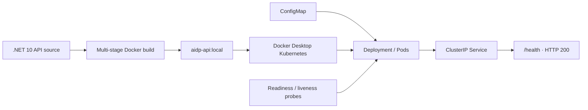
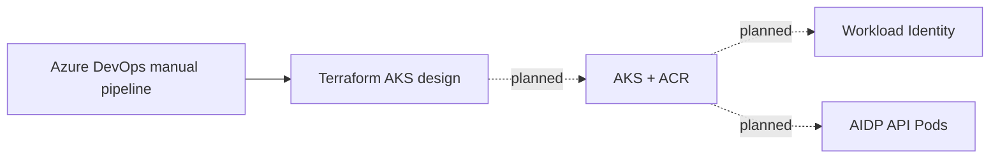

# ☸️ Kubernetes, AKS design & Azure teardown

[← Back to AIDP home](../../README.md) · [Recruiter case study](portfolio-summary.md) · [Troubleshooting evidence](troubleshooting-guide.md)

> [!NOTE]
> **Scope matters:** Kubernetes was **deployed and troubleshot locally**. AKS/ACR were **designed and validated at configuration level, not deployed**. The original App Service-based Azure lab was subsequently **decommissioned**, rather than migrated.

## 30-second overview

I containerized an existing **.NET 10 API**, deployed it to **Docker Desktop Kubernetes**, exercised real-world failure scenarios and recovery workflows, then designed an Azure Kubernetes Service migration with Terraform and manual Azure DevOps approvals. Because the project was time-boxed and cost-sensitive, I stopped before creating AKS and fully retired the AIDP Azure lab.

| Workstream | Result | Dive deeper |
| --- | --- | --- |
| 🐳 Docker and Kubernetes | API image, Deployment, ConfigMap, ClusterIP Service, `aidp-dev` namespace, HTTP 200 `/health` | [Local deployment](local-deployment.md) |
| 🔁 Day-2 operations | Replica scaling, resource limits, readiness/liveness probes, rolling update and rollback | [Local deployment](local-deployment.md) |
| 🔧 Incident response | ImagePullBackOff, Running-but-not-Ready Pod, CrashLoopBackOff and rollback recovery | [Failure drills](troubleshooting-guide.md) |
| 🏗️ AKS migration design | Separate Terraform root, Azure CNI Overlay, ACR, Workload Identity, least-privilege RBAC | [Architecture — not deployed](aks-architecture.md) |
| 🚦 Release controls | Manual-only Azure DevOps Validate/Plan/approved Apply/reviewed Destroy design; Plan blocked by state-account HTTP 403 | [Pipeline design](aks-pipeline-design.md) |
| 🧹 Azure lifecycle | Destroyed App Service workload and platform; resolved partial provider purge and unmanaged monitoring action group; removed Terraform backend after secure backup | [Completed teardown](azure-cleanup-runbook.md) |

## Hands-on architecture — what actually ran

**Actual local validation:** image built, API health returned HTTP 200, Service endpoints followed ready Pods, and incorrect image/probe/command settings were diagnosed and rolled back.

## AKS design — deliberately not deployed

The pipeline's Validate stage passed; remote-state firewall restrictions returned HTTP 403 during Plan. **No AKS cluster, ACR, AKS workloads, or App Service-to-AKS traffic migration was created.** See the [migration runbook](aks-migration-runbook.md) for the unexecuted plan.

## Troubleshooting highlights

| Scenario | Signal | Root cause | Recovery |
| --- | --- | --- | --- |
| ImagePullBackOff | Replacement Pod cannot start | Nonexistent image tag | Inspect Pod events and roll back image |
| Readiness failure | Pod `Running`, `0/1 Ready` | Incorrect probe URL returns 404 | Correct probe via rollback; validate Service endpoints |
| CrashLoopBackOff | Container exits repeatedly | Intentionally failing process command | Inspect exit code, events and previous logs; roll back |
| Rolling update | Replacement Pods managed by ReplicaSets | Image revision change | Monitor rollout and endpoints, undo when needed |

Detailed observed symptoms, commands and recovery: **[Kubernetes troubleshooting guide](troubleshooting-guide.md)**.

## Completed Azure cleanup — November 4, 2026

**3 workload resources destroyed · 35 platform resources targeted in the initial plan · 5 private state backups · 0 remaining AIDP-named Azure resources in the final inventory.**

The cleanup required resolving a partially completed Foundry purge and an unmanaged Application Insights Smart Detection action group before removing the main resource group. The remote-state storage account was deleted **last**, after the states were backed up. Both AIDP resource groups returned `false` on Azure CLI existence checks.

> [!CAUTION]
> A name-based inventory is not a complete subscription audit. Azure Cost Management can post delayed usage charges, so this document does **not** claim a verified final $0 invoice. Terraform state files remain private.

## Explore all documentation

| Guide | Best for |
| --- | --- |
| [Portfolio case study](portfolio-summary.md) | Recruiters, interviews, résumé bullets |
| [Local Kubernetes deployment](local-deployment.md) | Reproducing completed hands-on exercises |
| [Failure simulation and recovery](troubleshooting-guide.md) | Kubernetes debugging and day-2 operations |
| [AKS architecture](aks-architecture.md) | Technical design and limitations |
| [AKS migration runbook](aks-migration-runbook.md) | Hypothetical next steps; not executed |
| [AKS pipeline design](aks-pipeline-design.md) | Release and approval controls |
| [Azure teardown report](azure-cleanup-runbook.md) | Terraform lifecycle, cleanup and cost hygiene |
