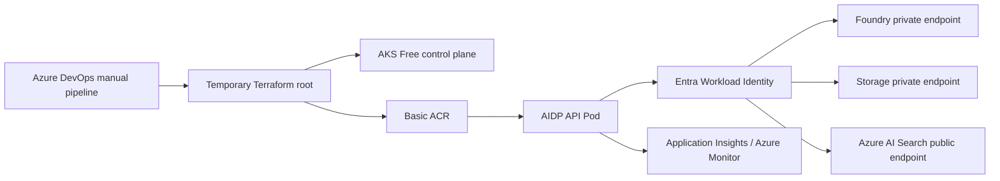

# Planned AKS architecture

This is a design artifact, not evidence of a deployed AKS environment.

## Designed components

- Existing VNet `10.20.0.0/16`
- Dedicated candidate subnet `10.20.3.0/24`
- Azure CNI Overlay Pod CIDR `10.244.0.0/16`
- Service CIDR `10.96.0.0/16`
- DNS service IP `10.96.0.10`
- Two candidate `Standard_D4s_v6` system nodes
- AKS Free tier
- Basic ACR with admin authentication disabled
- OIDC issuer and Entra Workload Identity
- User-assigned API identity and federated Kubernetes service account

## Identity design

The planned service account `aidp-api` in namespace `aidp-dev` would federate to a user-assigned identity. Runtime roles were intentionally disabled by default. The proposed least-privilege roles are:

- `AcrPull` for the AKS kubelet identity
- Cognitive Services OpenAI User for model invocation
- Search Index Data Contributor for document access
- Search Service Contributor for Provisioner-only index administration
- Storage Blob Data Reader for knowledge access

These permissions were not granted as part of this learning phase.

## Networking and cost boundaries

Foundry and Storage were designed to remain reachable through existing private DNS/private endpoints. Search remains public in the lab design because the Free tier does not support the intended private endpoint pattern. No ingress, NAT Gateway, or public application service was created.

AKS would also create an Azure-managed `MC_*` resource group containing infrastructure such as VM scale sets, disks, load balancer, and public IP resources. Those resources must be inventoried during teardown.
