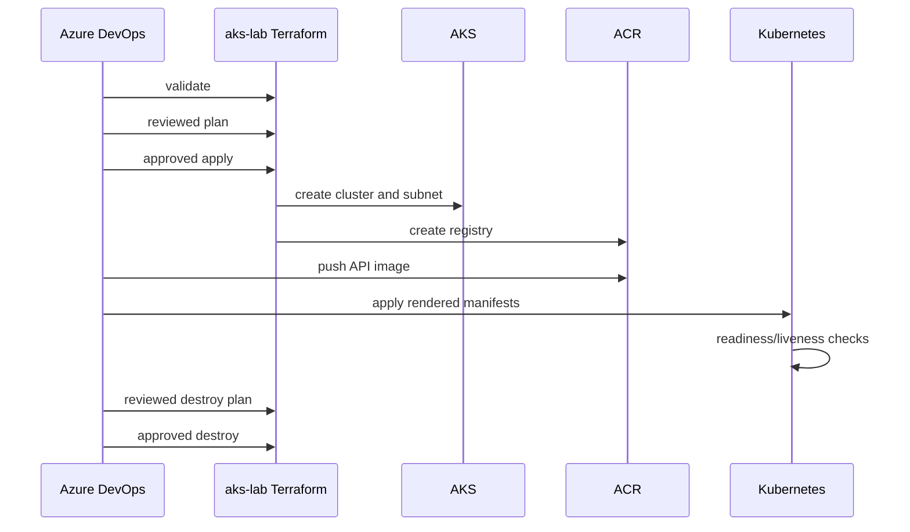

# AKS migration runbook — design only

This runbook describes the remaining work. It was not executed.

## Preconditions

1. Confirm current region, quota, VM SKU availability, subnet availability, and pricing.
2. Confirm the Azure DevOps WIF identity can create the temporary subnet, AKS, ACR, managed identity, and federated credential.
3. Configure approval checks for `aidp-aks-apply` and `aidp-aks-destroy`.
4. Confirm the isolated backend key is `aks-lab/dev.tfstate`.
5. Resolve the state-storage firewall access problem for Microsoft-hosted agents.
6. Build and push the API image to ACR.
7. Render the `k8s/aks/` templates with approved non-secret values.

## Intended sequence

## Not executed

- AKS creation
- ACR creation or image push
- Workload Identity token exchange in Azure
- Runtime RBAC assignments
- Kubernetes deployment to AKS
- App Service cutover or DNS change
- App Service compute removal

## Failure handling

Treat an Apply failure as a partial deployment until a fresh plan proves otherwise. Inspect the isolated state, reconcile the actual Azure inventory, and use the reviewed destroy workflow only after confirming that shared platform resources are outside the temporary state.
